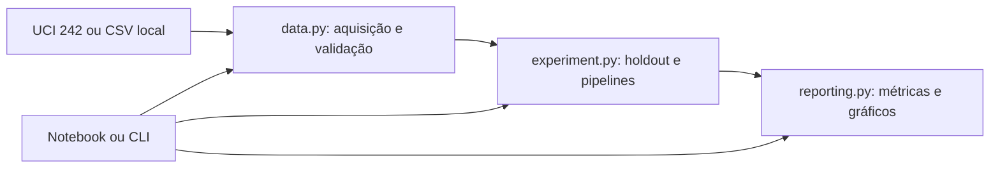

# Classificação de Eficiência Energética — Estudo Acadêmico

Projeto desenvolvido para uma atividade prática da disciplina de **Inteligência Artificial e Computacional**, da **Universidade Feevale**, com foco na construção e avaliação de modelos de classificação supervisionada.

O trabalho utiliza o dataset público **Energy Efficiency, UCI ID 242**, para comparar Árvore de Decisão, KNN e Regressão Logística. A carga de aquecimento foi transformada em duas classes relativas à mediana do conjunto, permitindo realizar o experimento de classificação proposto.

A análise contempla exploração dos dados, pré-processamento, comparação de acurácia, precisão, recall, F1-score e tempo de treinamento, além de matrizes de confusão e visualização da árvore. **As classes não representam uma certificação energética oficial**, nem estimam consumo real de um edifício em produção.

## Origem acadêmica e evolução do projeto

A versão original foi desenvolvida em um notebook como parte da entrega acadêmica, acompanhada de um relatório com a caracterização do dataset, os procedimentos de pré-processamento e a discussão dos resultados.

Posteriormente, o projeto recebeu melhorias de engenharia para facilitar sua manutenção, execução e apresentação em portfólio: modularização, interface de linha de comando, validação de dados, testes automatizados e configuração de integração contínua.

Essas melhorias preservam o protocolo experimental original e são documentadas separadamente dos resultados e conclusões do relatório acadêmico. A configuração de CI foi adicionada ao repositório; sua execução remota ainda não foi verificada. Consulte as [decisões técnicas](docs/decisions.md) e a [validação com os dados originais](docs/real-data-validation.md).

## Funcionalidades implementadas

- Obtenção do dataset pela UCI ou leitura de CSV local.
- Validação de esquema, alinhamento, tipos e valores ausentes/não finitos.
- Binarização de Y1 pela mediana global, com igualdade pertencendo à classe 0.
- Holdout 70/30 com semente 42, sem estratificação, preservando o estudo original.
- Árvore com entropia e profundidade 4; KNN com 5 vizinhos; regressão logística com até 1.000 iterações.
- Normalização ajustada apenas no treino para KNN e regressão logística.
- Métricas por classe, tabela comparativa, sete gráficos e relatórios JSON/CSV.
- Notebook e CLI que utilizam a mesma implementação.

## Arquitetura e tecnologias



Python 3.12, pandas/NumPy para dados, scikit-learn para modelos, Matplotlib para gráficos e ucimlrepo para a fonte oficial. O notebook usa Jupyter. Os testes utilizam `unittest`, da biblioteca padrão.

```text
src/energy_efficiency/
    data.py          aquisição e contrato de dados
    experiment.py    regra das classes, treinamento e avaliação
    reporting.py     geração de artefatos
    __main__.py      interface de linha de comando
Energy_Efficiency.ipynb
tests/test_workflow.py
```

## Instalação

Em um ambiente com Python 3.12 e acesso HTTPS ao PyPI:

```bash
python3.12 -m venv .venv
source .venv/bin/activate
python -m pip install -r requirements.lock
python -m pip install --no-deps --no-build-isolation -e .
python -m pip check
```

No Windows, ative com `.venv\Scripts\activate`. O lock registra as versões usadas nesta refatoração; não contém hashes de distribuição e não é uma garantia de reprodução bit a bit em todas as plataformas. Atualizações de dependências devem ser deliberadas e acompanhadas dos testes.

## Execução

Execute a partir da raiz do repositório:

```bash
python -m energy_efficiency --output artifacts/uci
# Equivalente após instalação:
energy-efficiency --output artifacts/uci
```

A UCI exige acesso a `https://archive.ics.uci.edu`. Não são necessárias chaves de API. Em ambiente sem interface gráfica, defina `MPLBACKEND=Agg`.

Para trabalhar com uma cópia local legítima dos dados:

```bash
python -m energy_efficiency --data data/energy.csv --output artifacts/local
```

O CSV deve ter cabeçalho com `X1,X2,X3,X4,X5,X6,X7,X8,Y1`, ao menos dez linhas, números finitos e ambas as classes no treino e teste. A ordem das colunas é normalizada. `Y2` e outras colunas são ignoradas. Dez linhas são um mínimo operacional de validação, não recomendação de tamanho para análise científica. Nenhum dado sintético substitui automaticamente a fonte real.

Os oito atributos representam compacidade, áreas de superfície/parede/telhado, altura, orientação e área/distribuição de vidro. Consulte definições e unidades na [fonte oficial](https://archive.ics.uci.edu/dataset/242/energy+efficiency). Y1 é carga de aquecimento; Y2 (resfriamento) está fora do recorte deste estudo.

Os comandos imprimem a comparação e geram:

- `metrics.json`: protocolo, versões, origem e métricas por modelo;
- `comparison.csv`: acurácia, precisão/recall/F1 macro e tempo de ajuste;
- histogramas, distribuição de altura/classes, três matrizes de confusão e árvore.

Reutilizar o mesmo diretório atualiza arquivos com os mesmos nomes; use diretórios distintos para preservar execuções. Os artefatos e dados locais ficam fora do Git. O tempo inclui o ajuste do scaler nos pipelines e é uma observação local, não benchmark controlado.

## Notebook

Selecione o kernel do ambiente instalado:

```bash
python -m ipykernel install --user --name energy-efficiency --display-name "Energy Efficiency"
```

Abra `Energy_Efficiency.ipynb` no VS Code/Jupyter e execute em ordem. Para execução automatizada, sem modificar o arquivo original:

```bash
mkdir -p artifacts/notebook
python -m nbconvert --to notebook --execute Energy_Efficiency.ipynb \
  --ExecutePreprocessor.kernel_name=energy-efficiency \
  --output executed.ipynb --output-dir artifacts/notebook
```

A variável `DATA_CSV` permite selecionar CSV local no notebook. Os gráficos são salvos em `artifacts`, relativo ao diretório de execução.

## Testes e CI

```bash
MPLBACKEND=Agg python -m unittest discover -s tests -v
```

Os testes verificam fronteira da mediana, entradas inválidas, leitura local, contrato da UCI com simulação de respostas, equivalência de predições ao fluxo original, ausência de ajuste do scaler no teste e consistência dos artefatos. As massas sintéticas existem somente nos testes, sem interpretação de desempenho energético.

GitHub Actions executa essa suíte sem depender de acesso à UCI durante os testes. Uma execução real deve ser validada separadamente com o comando da CLI; o sucesso da CI não comprova disponibilidade da fonte externa.

## Decisões e limitações

- Funções e módulos pequenos separam responsabilidades; não há necessidade de serviços ou hierarquias de classes.
- Pipelines mantêm scaler e classificador juntos para reduzir risco de pré-processamento inconsistente.
- A mediana global é preservada por compatibilidade. Usa alvos do conjunto inteiro para definir a tarefa retrospectiva; não corresponde a avaliação prospectiva com limiar definido apenas no treino.
- A divisão aleatória única mede desempenho nesse holdout. Não comprova generalização a edifícios independentes ou a outras populações.
- Orientação e distribuição de vidro mantêm a codificação numérica original; avaliar tratamento categórico é uma mudança metodológica futura.
- Não há persistência de modelo, API de inferência ou integração com LLM. O fluxo atual é de experimentação e comparação.
- Validação com a planilha original fornecida pelo autor: 768 linhas, mediana 18,95, treino/teste 537/231. Acurácias reproduzidas: árvore 96,10%, KNN 97,40%, regressão logística 97,84%. As predições dos três modelos foram idênticas às do código original executado sobre os mesmos dados. CLI e notebook passaram. O download direto pela UCI continua bloqueado pelo proxy; essa limitação não impede a execução via CSV local. Consulte a [validação com dados originais](docs/real-data-validation.md).

Consulte [decisões e validação](docs/decisions.md) para contexto da refatoração.

## Evoluções propostas — não implementadas

Baseline simples, validação cruzada, avaliação por grupos de edifícios e limiar definido no treino. Uma API ou persistência de modelos pode ser útil em uma etapa posterior com contrato de inferência bem definido. LLM, RAG e agentes não têm uma necessidade demonstrada neste escopo; qualquer integração deve ter objetivo e avaliação próprios antes de adicionar dependências ou custos.
